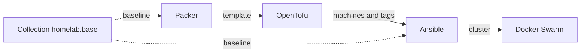

# atilili-homelab

The infrastructure behind my homelab: a Proxmox cluster, a remote site and a
VPS. Nothing here is deployed by hand.

These repositories are mirrors. The source is a self-hosted Forgejo, which also
runs the CI, hence the `.forgejo/workflows` directories.

## The chain

Packer bakes the Debian template, OpenTofu clones it and tags the machines, and
Ansible reads those tags as inventory groups to configure them. The baseline
roles sit in a shared collection, so they are written once and applied both at
build time and at bootstrap.

## Repositories

| Repository                                                              | What it holds                                                                                                      |
| ----------------------------------------------------------------------- | ------------------------------------------------------------------------------------------------------------------ |
| [`packer`](https://github.com/atilili-homelab/packer)                   | Debian templates for Proxmox VE                                                                                    |
| [`ansible`](https://github.com/atilili-homelab/ansible)                 | Playbooks and roles: VM baseline, Docker Swarm, DNS, OpenBao, rootless CI runner, backups to Proxmox Backup Server |
| [`renovate-config`](https://github.com/atilili-homelab/renovate-config) | Shared Renovate preset, inherited by the other repositories                                                        |
| [`template`](https://github.com/atilili-homelab/template)               | Repository skeleton: Nix dev shell, pre-commit hooks, CI                                                           |

OpenTofu and Docker Swarm will joins them once its refactor is done.

## Tooling

- A Nix flake pins every tool, so a local run and a CI run use the same
  versions.
- gitleaks and pre-commit on each push, ansible-lint inside the same execution
  environment that later runs the playbooks.
- Renovate opens the dependency updates, the CI decides whether they pass.
- Third-party actions are pinned by digest, not by tag.

## Workstations

My Desktops are configured apart, in
[atilinixos](https://github.com/Atilil/atilinixos): NixOS and home-manager with
flake-parts.
